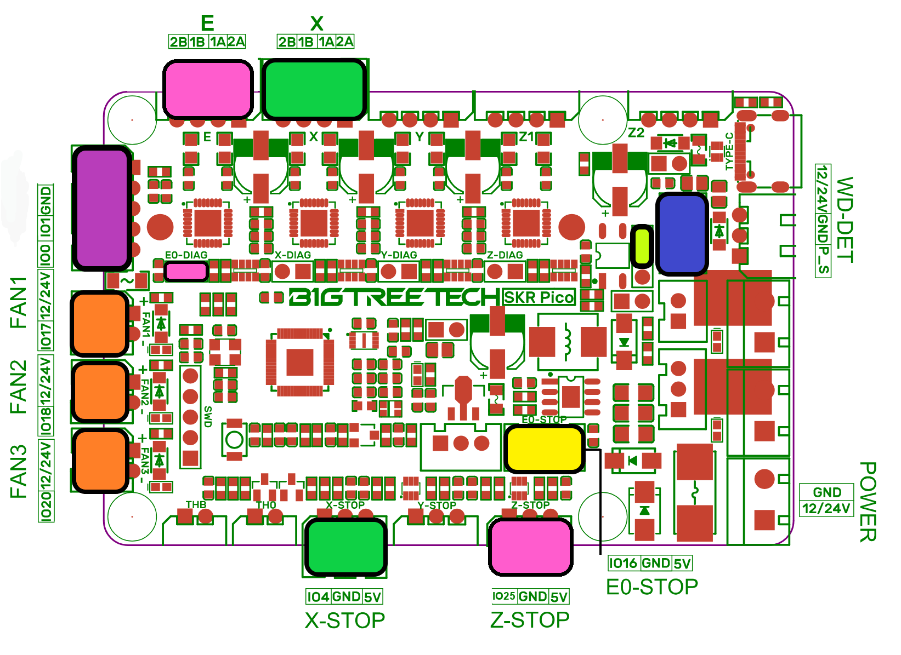
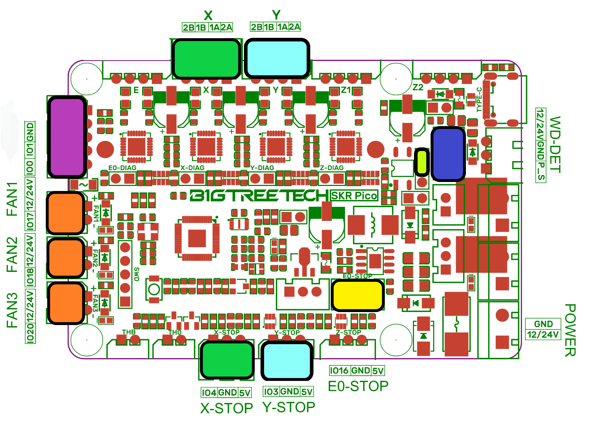

# Building a SortIQ Pico machine

The servo carousel and the sort arm both run on an SKR Pico board beside
a Raspberry Pi. The whole build is five steps, and nothing needs setting
up by hand afterwards:

1. **Print the parts.** The carousel's prints, renders and parts list are
   in [hardware/carousel](../hardware/carousel/), and the controller case
   is in [hardware/pico-controller](../hardware/pico-controller/). The
   optional 7" touchscreen's mount is in
   [hardware/touchscreen](../hardware/touchscreen/).
2. **Build and wire it.** Follow the [SKR Pico wiring](#skr-pico-wiring)
   and [Pi header connections](#pi-header-connections) below.
3. **Set up the Pi.** Flash Raspberry Pi OS Lite (64-bit) with the
   Raspberry Pi Imager, then run the installer from your computer, exactly
   as in [QUICK_START.md](QUICK_START.md) steps 1 and 2:

   ```
   tools/pi_deploy.sh pisortiq@pisortiq.local
   ```

   It installs the app and sets the Pi up for the SKR Pico (board link,
   LED ring, I²C, logs), then reboots the Pi. Plug the touchscreen in
   first if you have one, and the installer sets that up too.
4. **Flash the SKR Pico.** The firmware images ship ready to flash; see
   [Flashing the SKR Pico](#flashing-the-skr-pico).
5. **Power it up** and open `http://pisortiq.local:5000`. The app finds
   the board on the Pi's header UART, recognises which machine it is, and
   applies that build's reference settings, including the carousel's
   9-slot layout with the open pocket. From here, collecting and training
   work exactly as in [QUICK_START.md](QUICK_START.md) step 4 onwards.

## The two machines

| | Sort arm (`SortIQ-Pico`) | Carousel (`SortIQ-PicoServo`) |
|---|---|---|
| Board link | Pi GPIO UART (TFT header), **not** USB | same |
| LED ring | Pi GPIO 18 hardware PWM | same |
| Sort routing | stepper arm on the board | 8 servo doors on a **PCA9685 on the Pi's I²C** |
| 24 V IoT relay | optional, on GPIO 25 | same |
| Case feeder | — | optional, on the same SKR Pico ([Case feeder](#case-feeder)) |

### SKR Pico wiring

| Carousel (SortIQ-PicoServo) | Sort arm (SortIQ-Pico) |
|---|---|
|  |  |

The two harnesses are the same except for the sort arm's **Y** motor and
**Y-STOP** opto, in cyan. The carousel's optional case feeder is in pink. On the Pi's side, only the carousel has the
PCA9685.

| Colour | Header | Connects to |
|---|---|---|
| Purple | TFT header (IO0 / IO1 / GND) | The Pi's UART: board TX to Pi RX (pin 10), board RX to Pi TX (pin 8), ground to ground. This is the board link, `/dev/serial0`. **Only those three wires.** The Pi runs from its own power supply, so the header's 5 V power wires must be removed or left unconnected. |
| Green | **X** motor and **X-STOP** (GPIO 4) | The feed wheel stepper and its slotted homing opto. Pull the X DIAG jumper. |
| Cyan | **Y** motor and **Y-STOP** (GPIO 3) | **Sort arm only:** the arm stepper and its slotted homing opto. Pull the Y DIAG jumper. |
| Orange | FAN1 (IO17), FAN2 (IO18), FAN3 (IO20) | FAN1 and FAN2 are the controller case fans, FAN3 is the camera fan. All three are plain two-wire fans at full speed from boot; the app does not control them. |
| Yellow | E0-STOP, 5 V and GND only | Power for the LED ring's MOSFET module. The ring's PWM comes from the Pi's GPIO 18, so the ring is dark whenever the board is off. |
| Blue | WD-DET (12/24V · GND · P_S) | The M8 inductive case sensor: brown to 12/24V, blue to GND, black to P_S. HIGH on GPIO 22 means a case is staged. |
| Lime | "Proximity Switch" jumper (P_S · IO22) | **Fitted.** It carries WD-DET's conditioned output to GPIO 22. Without it the sensor's LED lights but the firmware never sees a case. |
| Pink | **E** motor, **Z-STOP** (GPIO 25), **E0-DIAG** jumper | **Carousel with a case feeder only:** the feeder motor, its break-beam sensor, and the jumper fitted for jam detection. See [Case feeder](#case-feeder). |

**Case sensor gotchas.** Remove the board's **NPN** jumper for a PNP
sensor such as the LJ8A3 `-Z/BY`; fit it only for an NPN `-Z/BX`. And
the sensor plugs into **WD-DET**, not the identical-looking **Laser**
header next to it: the Laser header's signal pin is FAN3's output
(IO20), so a sensor there lights up but never reaches GPIO 22.

### Case feeder

The carousel can run a case feeder from its own SKR Pico, so one board
and one app control the whole machine. The feeder is the case feeder from
[Case Feeder Pro](https://github.com/yamanub/Case-Feeder-Pro) (its prints,
motor and break-beam sensor are listed there). Build the feeder from that
project, but leave out its controller and touchscreen: its motor and beam
sensor wire to the carousel's SKR Pico instead.

| Feeder part | SKR Pico connection | Notes |
|---|---|---|
| Feeder motor (NEMA 17, 51:1 gearbox) | **E** motor connector | 950 mA, set by the firmware. If the plate turns the wrong way, don't rewire: turn on **Reverse the motor direction** on the Case feeder card |
| Break-beam **receiver** | **Z-STOP**: signal to `IO25`, plus `5V` and `GND` | Sits at the feeder's outlet. A case in the beam reads LOW; for a receiver that reads HIGH, turn on **Beam reads HIGH with a case in it** |
| Break-beam **emitter** | **Z-STOP** `5V` and `GND` | Shares the receiver's connector |
| **E0-DIAG** jumper | **Fitted** | Carries the feeder driver's stall signal to GPIO 16 for jam detection. The LED ring's MOSFET module keeps using only E0-STOP's `5V` and `GND` pins (yellow), never its signal pin |
| **Z-DIAG** jumper | **Removed** | Otherwise the Z driver's DIAG drives the beam input |

The feeder runs from the board's 24 V, so it is off whenever the board is.

**Turning it on:** power up, then Machine tab → **Hardware** → tick
**Case feeder**. The **Case feeder** card appears on the Machine tab
(Go/Stop, speed, the empty warning and shutoff times, start and stop with
sorting, jam detection, motor direction, beam level), and a feeder strip
appears on the Sort page and the touchscreen. With **Start and stop with
sorting** on, a sort run starts the feeder and, on an empty machine,
holds the wheel until the first ten cases have passed the feeder's beam.

With the feeder fitted, the jumpers are: X-DIAG **out**, Y-DIAG **out**
(sort arm only), E0-DIAG **in**, Z-DIAG **out**.

### Pi header connections

Physical pin numbers on the Pi's 40-pin header, the same on a Pi 4 and a
Pi 5. The Pi takes its power from its own supply only: nothing on this
list feeds 5 V into the Pi.

| Pi pin | Signal | Connects to |
|---|---|---|
| 8 | GPIO 14 (TXD) | SKR Pico TFT header RX (IO1) |
| 10 | GPIO 15 (RXD) | SKR Pico TFT header TX (IO0) |
| 6 | GND | SKR Pico TFT header GND |
| 12 | GPIO 18 (PWM) | LED ring MOSFET module, TRIG |
| 14 | GND | LED ring MOSFET module, the ground beside TRIG |
| 3 | GPIO 2 (SDA) | PCA9685 SDA (carousel only) |
| 5 | GPIO 3 (SCL) | PCA9685 SCL (carousel only) |
| 1 or 17 | 3.3 V | PCA9685 VCC, logic power only (carousel only) |
| 9 | GND | PCA9685 GND (carousel only) |
| 22 | GPIO 25 | IoT Relay `+` (optional) |
| 20 | GND | IoT Relay `−` (optional) |

Two supplies never touch the Pi's header:

- **The MOSFET module's power** comes from the SKR Pico's E0-STOP header
  (5 V and GND). Only its trigger pair goes to the Pi.
- **The servos' power** comes from the separate 5 V supply into the
  PCA9685's `V+` terminals. Tie that supply's negative to the PCA9685's
  ground so the servos share the Pi's reference; without the common
  ground they twitch or ignore commands.

The full pin tables live in the firmware READMEs:
[SortIQ_Pico](../firmware/SortIQ_Pico/README.md) and
[SortIQ_PicoServo](../firmware/SortIQ_PicoServo/README.md).

---

## What the installer sets up on the Pi

`tools/pi_deploy.sh` runs `tools/pi_host_setup.sh` on the Pi, which does
all of this once and reboots when a boot setting changed. Nothing here
needs doing by hand; it is listed for reference and for checking a Pi.
Re-running is safe, and `~/SortIQ/tools/pi_host_setup.sh --check` on the
Pi reports anything missing without changing it. None of it affects a
CS7.2 on USB.

- **Board link:** `enable_uart=1` in `config.txt`, the serial console
  removed from `cmdline.txt`, and on a Pi 3 or 4 `dtoverlay=disable-bt` so
  Bluetooth does not hold the UART.
- **LED ring:** `dtoverlay=pwm,pin=18,func=2`, plus `ring-pwm.service` to
  re-arm GPIO 18 at every boot. GPIO 18 is `PWM0_CHAN0` on a Pi 4 and
  `PWM0_CHAN2` on a Pi 5; the service and the app both ask `pinctrl get 18`
  which one, so the same setup serves both.
- **I²C** for the carousel's PCA9685, written through `raspi-config` so it
  survives reboots, and `i2c-tools`.
- **Permissions:** the app's user joins `dialout`, `i2c` and `gpio`.
- **System log** kept across reboots, so `sudo journalctl -b -1` shows the
  boot before an unexplained drop.
- **Suyin camera:** USB power saving turned off for it when it is plugged
  in. The app also turns it off for whichever camera it opens, so this
  holds even on a Pi the installer never set up.
- **Touchscreen**, only when a screen is plugged into the Pi's HDMI (or
  was set up before): `cage`, `chromium` and `wlr-randr`;
  `sortiq-kiosk.service`, which opens `http://127.0.0.1:5000/screen` on
  the screen at every boot; `video=HDMI-A-1:1024x600M@60D
  vc4.force_hotplug=1` in `cmdline.txt` for the screen's mode; the
  `input` group, so the app sees touches and can wake the screen; and a
  hidden mouse pointer.

### Serial device names differ by Pi model

The app finds the SKR Pico on **`/dev/serial0`** by itself. That is a
stable symlink on both Pi models, which is why the app never uses a raw
`ttyAMA*` name:

| | Pi 4 | Pi 5 |
|---|---|---|
| `/dev/serial0` → | `ttyAMA0` | `ttyAMA10` by default; `ttyAMA0` once `enable_uart=1` |

A config that hardcodes `/dev/ttyAMA0` works on a Pi 4 and fails on a Pi 5.

### Checking a Pi

```
ls /dev/i2c-1 && sudo i2cdetect -y 1   # carousel: expect 40 (and 70 = all-call)
ls -l /dev/serial0                     # exists
grep -c 'console=serial0' /proc/cmdline # 0: the kernel console is off the UART
pinctrl get 18                         # PWM: Pi 5 "a3 ... PWM0_CHAN2",
                                       #      Pi 4 "a5 ... PWM0_0" (no CHAN -> channel 0)
cat /sys/class/pwm/pwmchip0/pwm*/enable  # 1 (pwm0 on a Pi 4, pwm2 on a Pi 5)
systemctl is-active sortiq ring-pwm
systemctl is-active sortiq-kiosk         # touchscreen: active
curl -s localhost:5000/api/feeder        # case feeder: "enabled":true and a status
curl -s localhost:5000/api/gates/state   # carousel: "available":true
```

---

## Flashing the SKR Pico

The images ship in the repo, so there is nothing to compile:

| Machine | Image |
|---|---|
| Servo carousel | `firmware/SortIQ_PicoServo/SortIQ-PicoServo-0.9.2.uf2` |
| Sort arm | `firmware/SortIQ_Pico/SortIQ-Pico-2.8.uf2` |

The board's logic runs off **24 V, not USB**, so it must be powered to
flash. With its 24 V off it never appears, whatever the USB cable is doing.

**First flash (a new board):**

1. Fit the **BOOT jumper** and connect the board's USB to the Pi.
2. Power the machine on.
3. On the Pi, run the script for your machine:

   ```
   ~/SortIQ/tools/flash_pico.sh carousel      # or: arm
   ```

4. **Remove the BOOT jumper.** With it fitted, every power-on lands back
   in the bootloader instead of the firmware.

From any computer instead of the Pi: with the jumper fitted and the board
powered, plug its USB into the computer, and copy the image from the
table above onto the
`RPI-RP2` drive that appears. Then remove the jumper.

**Updating a board that already runs SortIQ** needs no jumper. The script
asks the board to enter its bootloader over the link and picks the image
for the build this machine runs:

```
ssh pisortiq@<machine> '~/SortIQ/tools/flash_pico.sh'
```

The app reconnects on its own and sends the machine's settings again.

### First boot on a fresh board

Its EEPROM is empty, so the very first home runs on the firmware's
built-in defaults and may park a few steps off or throw a feed error. The
app writes the build's settings on its first connect, the board keeps
them, and every later boot homes correctly.

---

## Moving a machine to a different Pi

Everything the machine *is* lives in two files, plus two values on the
board. Copy the files; leave the new Pi's dataset and gallery alone.

| What | Where | Notes |
|---|---|---|
| Machine + camera tuning | `~/SortIQ/config.json` | wheel steps, homing offset, **per-door servo pulses**, drop delay, camera zoom/LED, relay flag, case feeder settings, screen sleep, `slots_enabled` |
| Bins, families, imaging, floors | `calibers/<cart>/<model>/model.json` | merge these keys only — keep the target Pi's `stamp_labels`, gallery and dataset |

Two values also survive on the board itself (EEPROM): wheel steps and feed
homing offset. Everything else is on the Pi's boot drive (SD card or NVMe).

**Back these files up** after any tuning session, and always before
repurposing a Pi or reflashing a card: copy `config.json` and every
`calibers/*/*/model.json` somewhere safe. The dataset and gallery are
deliberately not part of that set: they are gigabytes, and they live on
the trainer too.

To move: run `tools/pi_deploy.sh` against the new Pi first (it installs the
app and sets the Pi up), then copy the two files over and restart the app
with `sudo systemctl restart sortiq`. Power the board on and confirm a
clean home before running brass.
