# SortIQ User Manual

Everything is driven from a browser. Open **http://pisortiq.local:5000**
(or the Pi's IP address) from any computer, phone, or tablet on your
network. (New install? The step-by-step path is
[QUICK_START.md](QUICK_START.md).) A machine with
the optional 7" touchscreen can also be run from the machine itself; see
[The touchscreen](#the-touchscreen).

**What you need:** the assembled machine (a CS7.2, or a SortIQ Pico sort
arm or carousel) with its Raspberry Pi set up
([PI_SETUP.md](PI_SETUP.md)), and — when you're ready to train models — any
Mac or Windows PC on the same network ([TRAINER_SETUP.md](TRAINER_SETUP.md)).

**The header** (top of every page) is the machine's vital signs: the
machine's name (click to rename it), the active caliber and model, camera
status, a **board power** icon when an IoT relay is fitted (green = on;
click to switch the board from any tab), the Wi-Fi icon (click to manage
networks), and the gear for the **System** dialog. If something's
disconnected, it shows there first.

The nav reads left to right in workflow order — **Collect** images →
**Train** models → curate the **Dataset** → **Test** decisions → **Sort**
— with the system pages (Machine, Fleet, Docs) in their own group on the
right. The whole top bar tucks away as you scroll down a long page and
returns the instant you scroll up.

---

## Collect — building your dataset

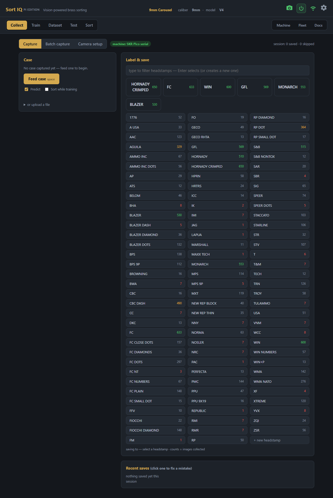

This is where a model is born: you feed cases and tell SortIQ what they are.

1. Make sure the machine chip (next to the view toggle) is green —
   `machine: <board> serial`.
2. Pick the headstamp you're feeding: the **top row** is your six biggest
   classes as instant-select buttons, and below it every class lists
   alphabetically (or type in the filter box — Enter selects, or creates
   a new class). The number on each button is how many images that class
   has, tinted by the same readiness thresholds as the Dataset tab:
   red under the 10-image training floor, amber at 300+ (novelty gate
   armed), green at 500+ (well-fed).
3. Press **Feed case** (or the spacebar): the machine feeds a case and
   the camera captures it. Check the class, then press **Save + feed**
   (the spacebar again) to file it and bring the next case. **Skip +
   feed** (F) moves on without saving; **Retake** (R) photographs the
   same case again.
4. With **Predict** checked, the current model guesses each case as it's
   captured — once your model is decent, you mostly just confirm.
5. Mislabeled one? **Recent saves** shows the last few captures — click
   one and it opens in the standard image viewer (the same one the
   Dataset tab uses): full photo and model crop, **Move** / **Delete**,
   and arrow keys to walk the neighboring images in that class.

A class starts **sorting from 3 photos** (it enters the exemplar gallery)
and joins the training pass at 10+; aim for 100–300 for the stamps you
care most about. At 300+ a save is skipped only when it's **pixel-verified
as the same physical case already filed** (matching scratch pattern at
some rotation — the re-run-the-brass situation). Distinct cases always
file, no matter how alike the stamp looks.

At **500+ images a class is "well-fed"** and switches from volume to
variety: in batch review its confirm-card offers **File novel**, which
keeps only photos that show the class a look it doesn't already hold in
depth, and skips the routine near-identical ones ("98 routine
look-alikes skipped"). **File all** overrides. Hard cases — the
"Looks like X" and unknown piles — always file in full; those are the
photos that teach the model the most. Each of those cards also explains
*why* the model hesitated: "FC 98% **vs R-P 94%**" means the winner was
confident but a look-alike class sat too close to auto-file.

**A note on variant classes:** if a headstamp arrives in visibly
different dies (`FC` plain vs `FC DOTS` vs `FC DIAMONDS`), give each
look its **own class** — a variant hiding inside its parent class
matches at coin-flip margins, while a split class matches decisively
after the next retrain. Then group the variants into a **family**
(Dataset tab) and assign the family to a bin: they sort together
physically, and a close call between two family members headed to the
same bin is accepted rather than rejected as ambiguous. The full
doctrine, including when a split is worth it and how to keep classes
clean: [TRAINING_GUIDE.md](TRAINING_GUIDE.md).

## Batch capture — label piles, not cases

The **Batch capture** toggle (top of the Collect tab) is the fast way to
collect: pour a pile into the hopper, press **▶ Start batch capture**,
and the machine photographs every case at full speed with no labeling in
the loop. The **Hopper** switch picks what the pile is:

- **Mixed lot** — any mix of headstamps; you file the photos by group
  afterwards (below).
- **One class** — a pile you already know is all one headstamp, such as a
  hand-sorted bag. Pick the class (it must already exist). When the
  hopper empties, the machine checks every case against that class and
  files the ones that look like it. It holds three kinds for you: cases
  that **read as another class**, cases that look **nothing like** the
  class, and cases it is **not sure** of. **Review** lists each held case
  with its reason, to file as the class, as what it read, as another
  class, or to discard (or **File all as** / **Discard all**).
 While it runs the page mirrors the Sort page: the case in the nest
shows big on the left (a confident read is named; anything else shows
**unrecognized** with the model's best guess as a footnote), and beside
it the **hopper census** grows a pill per recognized class — what that
pile is made of, live.

When the run ends, **Review** opens the batch review: a wall of group
tiles — recognized classes, **Looks like X** piles the model wouldn't
auto-file, and clusters of same-looking unknowns — each with its count.
Click a tile to work that group: the familiar confirm-card (File / File
novel / Discard, one class picker per group, big pages of 50 thumbs),
and clicking any photo pulls it out of its group — pulled-out cases
collect in a floating bar to be filed to their real class or discarded
on their own. Resolved groups keep a receipt on their tile, and the
picker holds the five most recent batches.

## Camera setup

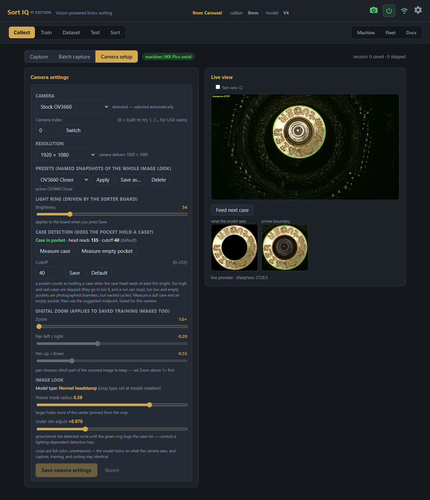

The **Camera setup** toggle (top of the Collect tab) is the machine's eye
exam:

- **Camera** — the module is auto-detected and shown in the **Camera**
  selector (the stock **OV3660**, or the **Suyin HD** 50° module); pick
  it by hand if the detection is wrong. The page offers only the
  controls that do something on that module: the resolutions it really
  has, the **light ring** slider (the ring is powered from the sorter
  board — the board must be on for light), and **digital zoom/pan**.
  Lighting settings travel with the camera: switching models restores
  the ring level saved for the one you switch to.
- **Live view** — with the head-detect circle and a live sharpness number
  (use it when focusing the lens). **Feed next case** cycles brass without
  leaving the page. Below it: the exact crop the model will see.
- **Case detection** — how bright a case head must read for the pocket
  to count as holding a case. A live line shows what the camera sees
  right now (*Case in pocket*, *Empty pocket*, or *Case too dim to
  count*) with the head brightness and the cutoff in force. To set it:
  put a dull case in the camera pocket and press **Measure case**, empty
  the pocket and press **Measure empty pocket**, then use the suggested
  midpoint and **Save**. Too high and real cases are skipped (they go to
  bin 9, and a run can stop with *camera saw empty pockets*); too low and
  empty pockets get photographed. The value is saved per camera;
  **Default** goes back to the built-in value.
- **Image look** — the crop dials (primer mask radius, rim adjust). These
  belong to the *model profile*, not the camera, and are always safe to
  change: crops rebuild from the raw images.
- **Camera controls** (Suyin HD only; the OV3660 ignores every image
  control, so it has no card) — the module's own brightness, contrast,
  saturation, gamma and white balance. Two buttons show by default:
  **Calibrate white balance** locks the colour the camera picks by
  itself so every case is rendered the same (do it with a case at the
  camera, once the light ring is in its final position; exposure stays
  automatic — a manual exposure bright enough to match auto costs most
  of the frame rate), and the **Unlock controls** checkbox reveals the individual
  sliders for fine tuning. Sliders preview live on the stream but nothing
  applies until **Save camera settings**; **Revert** puts the camera
  back; **Reset to defaults** returns the module to its own factory
  values.
- **Presets** (any camera) — **Save as…** snapshots the saved look —
  resolution, zoom, controls, ring — under a name, and **Apply** brings
  it back, so a tuned setup is one click away after an experiment.

**Framing the headstamp — zoom and pan:** the digital **Zoom** slider
should be pushed up until the headstamp fills most of the frame — a
tiny stamp lost in a wide shot of the whole case head starves the model
of the pixels it needs to tell dies apart. Once zoomed in, use **Pan
left/right** and **Pan up/down** to re-center the primer in frame (pan
only has something to work with once Zoom is above 1×). Check the "what
the model sees" preview next to Live view after every adjustment — that
crop, not the full camera frame, is what gets saved and trained on.

**Brightness:** the **light ring** slider controls the only light this
matters — brighter isn't automatically better. Aim for a level where the
stamp's stamped letters and numbers read as crisp, dark marks against
the brass, with no blown-out glare washing them out and no murky
underexposed shadow hiding them. Nickel and reflective cases are the
hardest case: diffuse or lower the light rather than pointing it
straight on, since direct light glares out exactly the letters you need.

**Consistency matters:** the model learns the camera's exact look, so
avoid changing optics, zoom/pan, or lighting mid-dataset. If you change
the setup meaningfully, capture a fresh batch afterwards and rebuild the
gallery so the exemplars match what the camera now sees.

---

## Train — on your trainer PC

> **How you structure your classes matters more than how long you
> train.** [TRAINING_GUIDE.md](TRAINING_GUIDE.md) covers the doctrine:
> split every visually distinct variant into its own class, rejoin
> them with families for the bins, and keep the dataset clean with the
> scan loop. Ten minutes of reading that pays for itself in margins.

The Pi deliberately doesn't train (it's an inference machine — no
TensorFlow). Training runs on the trainer: the same SortIQ app running
on your Mac or Windows PC ([TRAINER_SETUP.md](TRAINER_SETUP.md)) — but
you drive it **from the machine's own page**: the Train tab's **Train
models…** button opens a window that finds the trainer on the PC you're
browsing from and walks the whole flow — sync the dataset, pick GPU or
CPU, watch progress, review the result's bench numbers, and install —
without ever leaving the machine's UI. (The trainer's own page at
`http://localhost:5000` offers the same controls if you prefer it.)

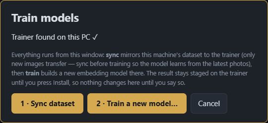

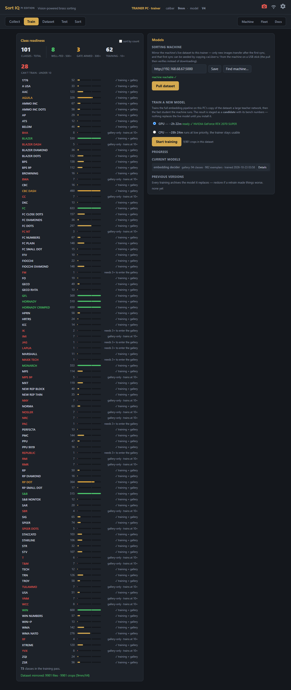

**Class readiness** opens with the dataset's health at a glance — four
jumbo tier counts: well-fed · 500+,
gate armed · 300+, training · 10+,
and can't train · under 10 (the
re-photo shopping list). Below, every class shows its image count and a
**bar filling toward 500**, with tick marks at the 10-image training
gate and the 300-image duplicate gate — a class closing on a gate is
visible at a glance. Every class with 3+ photos is live in the gallery
immediately — sortable today, no training needed; classes join the
periodic training pass (which sharpens the whole network) at 10+
images. Nothing is ever guessed: a class too thin to match confidently
sorts as *unmatched*. The list sorts A–Z or by count. While a sync or
training runs from the
**Train models…** window, the window stays up on purpose: leave the
machine idle until the job finishes (one heavy thing at a time).

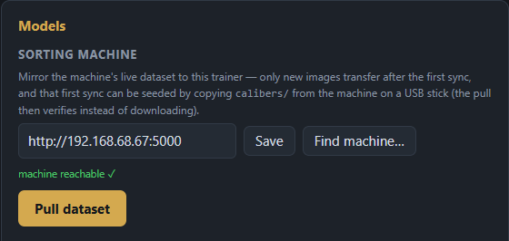

Set the **Sorting machine** URL once ("machine reachable ✓" confirms it),
then:

- **Pull dataset** — mirrors the machine's dataset to the trainer
  (incremental — after the first sync only new images transfer) and
  rebuilds the training crops. This mirrored copy feeds the embedding
  retrain when you run one.
- **Find machine…** — scans the local network for SortIQ instances and
  sets the URL with one click; works even when `.local` names don't
  resolve.
- **Train a new model** — a full retraining of the embedding network,
  run from the mirrored dataset. **Needs 100+ training crops across the
  whole dataset** — this is a dataset-wide floor, separate from any
  single class's 10-image training threshold, and a run below it is
  refused with an error rather than started. Keep collecting on the
  Collect tab (or **Pull dataset** here) until the trainer PC's copy
  clears it. Pick **GPU** (about an hour, when the
  trainer PC has the WSL GPU sandbox set up) or **CPU** (an overnight
  job at low priority — the PC stays usable), press Start, and watch
  the two stages: the large teacher network, then the fast student the
  machine actually runs. The result is staged as a **candidate** with
  its bench numbers — nothing changes on the machine until you press
  **Install**, which archives the current generation and pushes the new
  model + gallery pair over. If the GPU path fails, the app shows the
  error and asks: retry the GPU, or train on CPU instead? It never
  falls back silently.

If the trainer's code doesn't match the machine's, both Train UIs say so
and block training — models must be built by the same imaging code the
machine sorts with. One click (**Update trainer from machine**) brings
the trainer to the machine's exact code and restarts it; details in
[TRAINER_SETUP.md](TRAINER_SETUP.md). The gear's **System** dialog shows
each install's version and build (`SortIQ v1.6.0 — build 1a2b3c4d`), and
the **Fleet** tab shows every machine's build side by side, so you can
see at a glance whether machine and trainer are in step.

**Copy dataset to USB stick…** (Models card, on the machine) copies the
active model's photos to a USB stick: a backup, or a fast first pull on a
new trainer PC (see [Tips](#tips--troubleshooting)). Sorting can't start
while a copy runs.

The **Models** card shows the installed embedding decider with
its gallery stats (classes × exemplars). **Every install archives the
generation it replaces** — model and gallery together — so if a new
generation performs worse, restore the previous one from the *Previous
versions* list. Every row has a **Details** button.

Why an embedding model? Instead of being forced to pick one of its
trained classes, it produces a fingerprint that's *matched* against a
gallery of exemplar photos — so a stamp it has never seen matches nobody
and goes to UNMATCHED instead of a bin, and a brand-new class starts
sorting from 3 photos with no retraining at all.

### The community starter recognizer

A fresh install doesn't have to start blind. When a release publishes a
**starter** (the Train tab shows its card only then), it is a trained
9mm recognizer + gallery (80+ common headstamps) that sorts out of the box — turn on **auto-assign** and run brass
before you've collected a single photo. It's offered wherever it makes
sense: a **Download & install** row on the Train tab when there's
nothing to train yet, and a checkbox in the **New model** dialog when
the install has no recognizer of its own to lend. The download is
verified against a digest pinned in the code — a corrupted or tampered
file installs nothing. The starter is a loaner, not a ceiling: it has
never seen *your* camera, so treat its reads as a head start, collect
photos as you confirm them, and train your own model when the dataset
clears the floor — your own generation will beat the starter on your
machine every time. (No internet on the Pi? Download
`starter_9mm.tar.gz` from the release on another computer and serve or
host it anywhere reachable — the API accepts a URL override:
`POST /api/models/starter {"url": "http://…/starter_9mm.tar.gz"}`.)

---

## Dataset — curating your classes

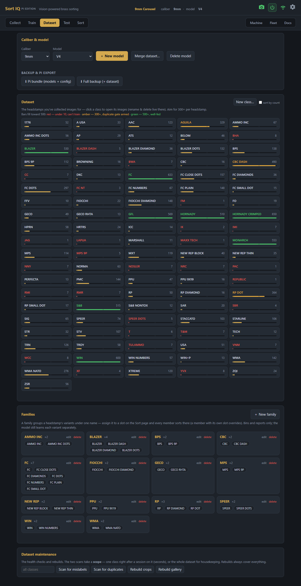

- **Caliber & model** — profiles are fully self-contained (dataset, crop
  settings, trained models). Create a new model to experiment — e.g. a new
  camera or crop style — or for a **second caliber**, without touching your
  proven one. Switching is instant. When creating one, **Start with the
  current recognizer** (on by default) lends the new profile your trained
  model's eye: it can tell headstamps apart even on brass it has never
  seen, so a new caliber can collect photos, rebuild its gallery, and
  start sorting immediately — train its own recognizer later for full
  accuracy. On a fresh install with no recognizer to lend, the dialog
  offers the **community starter** instead — see below.
  **Merge dataset…** copies another model's images into the
  active one, class by class (new classes are created, the source is
  left untouched; trained models are never merged) — the tool for
  consolidating an experiment's labels back into a main model.
- **Per class:** every class is a **card** — name, count, and the same
  readiness bar as the Train tab. Click a card and the class opens as
  a modal over the grid: exemplars on top, every image paginated below
  (inspect, move mislabeled images between classes, bulk-delete).
  **Rename…** and **Delete class…** sit on the brass banner at the
  top — rename onto an existing class's name to **merge** into it.
  The grid sorts A–Z or by count — count order doubles as the "what
  needs photos" view.
- **Exemplars** — when viewing a class, a dedicated card shows exactly
  which photos are doing the matching for it (★ picked automatically for
  coverage, 📌 pinned by you). Click a badge to pin a photo permanently
  into the gallery or exclude a bad one; changes take effect at the next
  gallery rebuild.
- **New class…** creates an empty class to collect into; **select
  multiple** in a class window moves or deletes a batch of photos at
  once. **Delete model** removes the active model profile, and **Backup &
  Pi export** downloads a **Pi bundle** (what another machine needs) or a
  **Full backup**.
- **Families** — group a headstamp's variants (`FC`, `FC DOTS`,
  `FC PLAIN`…) under one name; each family renders as a small card with
  the family name on top and its member classes as chips inside. On the
  Sort page the family assigns to a
  slot as a single unit, and run reports label the slot by the family.
  Grouping affects bins and reports only — the model still learns and
  reports each variant separately, so classes can multiply for accuracy
  while your physical bins stay simple. **Suggest members** pre-ticks
  every class starting with the family's name. Families also soften the
  "too close to call" gate in the one case where it can't matter: a
  coin-flip between two variants that share a family *and* a slot sorts
  anyway — the case lands in the same chute either way — while variants
  routed to different slots keep the strict gate. Families follow class
  changes: renaming a class renames it in its families, merging or
  deleting one takes it out, and a family left with a single class is
  removed, that class keeping the family's bin.
- **Set aside — identify later** — the tray at the top of the page
  collects unknown stamps from reject reviews and captures, clustered by
  similarity. Name a group once to create its class and file every photo
  in one go; discard what you don't want. The tray exists to be emptied.
- **Dataset maintenance** — a dedicated card holding the health checks
  and rebuilds below. The two scans take a **scope**: pick one class for
  a seconds-fast check right after a session on it, or *all classes* for
  full housekeeping. Rebuilds always cover everything.
- **Rebuild crops** — force-regenerates training crops from the raw
  images. Normally automatic; use it if you've changed files outside the
  app.
- **Rebuild gallery** — re-picks every class's exemplars from the current
  photos and pins. Run it after a relabeling session, after emptying the
  tray, or after big captures. Unchanged photos reuse their stored
  vectors, so rebuilds finish in seconds — only a model install (new
  vector space) or an imaging change pays the full price once.
- **Scan for mislabels** — the decider second-guesses every stored
  image, exactly the way live sorting reads a case — with one twist:
  each image's own gallery seat is masked while it's judged, so a
  mislabel that happens to be serving as an exemplar can't vouch for
  itself and hide. Anything that reads
  as a *different* class gets listed, sorted by confidence: the red
  high-confidence flags (70%+) are almost always saves that landed in
  the wrong folder mid-session — **View** jumps straight to the image so
  you can Move or Delete it. Low-confidence rows are usually just hard
  images (worn stamps, glare); leave them unless the photo agrees.
  The scan reads stored vectors, so the whole dataset checks in
  seconds — run it freely after big collection sessions and before
  retraining, and re-scan after fixing (mislabels can shelter each
  other; a clean dataset scans clean twice).
- **Scan for duplicates** — finds repeats of the *same physical case*
  (double-saves, the same brass re-run through batch capture) that
  inflate class counts without adding variety. Two stages: the
  embedding nominates look-alike candidates, then a pixel-level check
  confirms identity by matching the actual scratch pattern at every
  rotation — so genuinely different cases of a uniform stamp (which
  really do look alike) don't get flagged. Each confirmed group shows
  its photos with the sharpest marked **keep**: one click keeps it and
  deletes the rest, or **Different cases — keep all** if you disagree —
  nothing is ever deleted automatically, and a keep-all verdict is
  **remembered**: neither a page reload nor any future scan re-flags a
  pair you've already ruled on. Rebuild the gallery when you're done.

## Test — one case, every detail

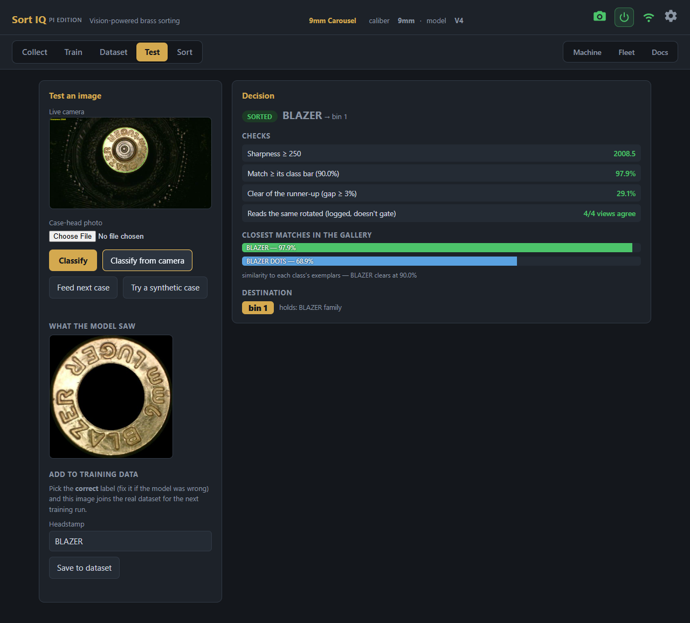

**Feed next case** runs one feed cycle and seats the next case under
the camera, so single-case checks are a self-contained loop right on
this page: feed, classify, feed again — no run, no other tab.

Feed a case (or upload an image) and see the entire decision the way the
run loop makes it: every gate (sharpness, class bar, runner-up margin,
rotation agreement) with its pass/fail value, the closest gallery matches
with their similarities, the exact crop the model saw, and the destination
bin. A reject explains itself in plain language ("Too close to call —
SPEER 91% vs BLAZER 89%"). When a sort surprises you, this page is where
you find out why in ten seconds — and the runner-up trail is how
mislabeled images get caught.

## Sort — live sorting

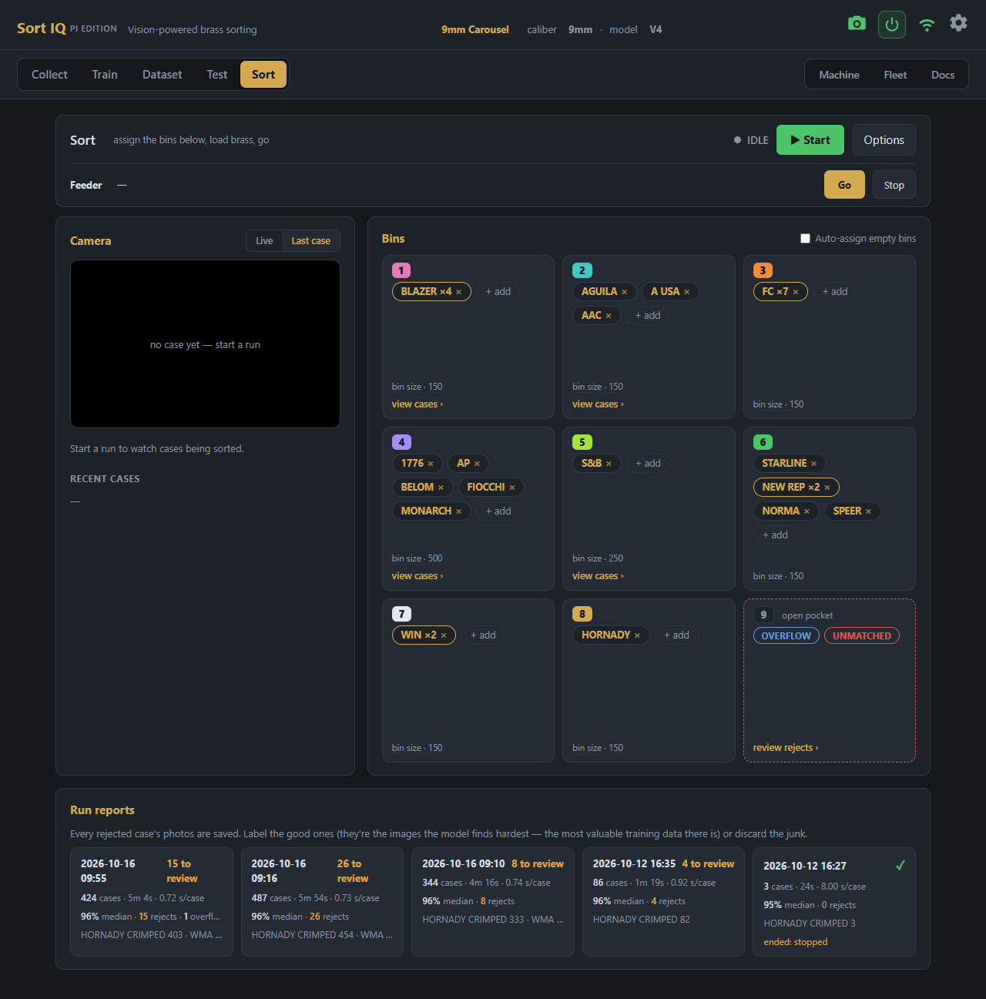

The page is a grid of **slot cards** — one card per physical bin — under
a top bar that follows the machine's state: **Start** when idle, live
stats with **❚❚ Pause** and **Stop** while sorting, the finished tally
afterwards. Beside the grid, the **Camera** card switches between the
live view and the last case. **Options** holds the run options: the
machine chip and Connect, the simulator, the **Acceptance** slider, the
sharpness floor, **Clear slots** and **Reset counters**. With a case
feeder fitted, a feeder strip runs along the top: its state, speed
presets and **Go** / **Stop**.

1. **Assign bins on the cards.** Click **+ add** on a card to open that
   bin's editor: three tiles of checkboxes — **families** (ticking one
   puts every member class in that slot, future members included; a
   member explicitly assigned to its own slot overrides its family),
   **classes** (each with its image count; A–Z, or tick *sort by count*
   to put the makes you have most of first), and the two special tokens.
   What the bin already holds comes up ticked — untick to remove it. A
   class sitting in another bin shows that bin's badge; tick it to move
   it here. A filter box narrows the list; **Save** writes everything
   at once. Exactly one card is **UNMATCHED** (red) — the catch-all
   where rejects land.
   Optionally give a second card **OVERFLOW** (blue): confidently-read
   stamps that have no bin of their own land there instead of riding
   the catch-all, so UNMATCHED holds only true rejects. Or leave cards
   empty and turn on **auto-assign** — new stamps claim free slots as
   they appear, and the assignments persist for next time.
   On the servo carousel the ninth position is an **open pocket** with
   no door, drawn as a full-width **Bin 9** card under the grid. Both
   tokens live there by default; either can be moved onto a gated bin
   from that bin's editor, and the **×** on the moved pill (or unticking
   it) sends it back. The pocket also catches anything that misses a
   door, so it never takes classes of its own.
2. **Set bin sizes** (optional, once): **set bin size** under a card's
   fill bar stores that tray's physical capacity. A sized bin's fill
   bar turns absolute — amber at 80% full, red with a **FULL** flag
   when the tray needs emptying; hover for the exact count/capacity.
   Unsized bins show fill relative to the busiest bin. Sizes live in
   machine settings, so they survive model switches.
3. **Pick bin colors** (optional): click a card's number badge while
   idle and choose from seven swatches — the badge, the recent-cases
   list, and run reports all wear the color, so "purple bin" reads at
   a glance across the whole app. Red and blue are never offered;
   they stay reserved for UNMATCHED and OVERFLOW. Clicking the chosen
   swatch again clears back to brass. Colors are machine settings,
   like sizes.
4. **Start.** The grid locks into a live dashboard: jumbo per-card
   counts, per-class breakdowns, fill bars, and a glow tracking the
   drops, while the top bar carries sorted / unmatched / jams / rate.
   The recent-cases list carries each case's bin badge in its color
   and a confidence figure — green at 95%+, amber below, red rows for
   rejects.
5. Anything below the confidence floors goes to **UNMATCHED** — the
   machine would rather make you re-run a case than put it in the
   wrong bin. (The **Acceptance** slider in **Options** shifts every
   class's bar together; 85% is neutral.)
6. **Pausing.** **❚❚ Pause** parks the wheel at the next case and closes
   the doors; **Resume** carries on in the same run. With a case feeder,
   a **tube jam** (the feeder's tube is full but no case reaches the
   wheel) or a **feeder jam** pauses the run the same way, and a card on
   every tab says what to clear, then **Resume** or **Finish run**. With
   **Start and stop with sorting** on, the run starts the feeder and, on
   an empty machine, shows *Waiting for the feeder* until the first ten
   cases have passed its beam.
7. **When brass stops arriving**, a **No brass arriving** card counts
   down 10 seconds on every tab. If a case is stuck in the feed tube,
   clear it and press **Resume**; **Finish run now** ends at once, and a
   case arriving closes the card by itself. When the run finishes, the
   last cases still inside the feed wheel are flushed to their correct
   slots, and the finished bar adds duration, seconds-per-case, and median
   confidence. **Report** opens the run as a modal over the page: a
   summary of vitals with a tile per bin (colored badge, count, top
   classes), and clicking a tile — or **view cases ›** on a card —
   drills into that bin's cases, grouped by class, assigned classes
   leading and riders labeled. Big bins page at 50 cases; click any
   photo to zoom the full frame.
8. **Rejects live in the report too** — every unmatched case was
   photographed, and the UNMATCHED bin's view leads with them, each
   one click from being filed into the training data so your next
   model learns from exactly what confused this one. **Past runs**
   live in the **Run reports** card at the bottom of the page — a
   tile per run (date, case count, duration, rejects still waiting
   for review); click one and the same modal opens.

## Machine — connection, calibration, settings

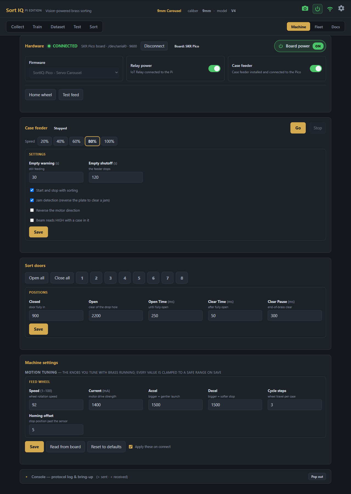

- **Hardware** — the connection, the board and the machine's optional
  equipment, in one card:
  - **The connection line** — offline it carries the target (sorter
    board or simulator), the port, and **Connect**; connected it folds to
    a green dot, the board-and-port summary, and **Disconnect**. A link
    reads CONNECTED only once the board has answered — a powered-off
    board on the header UART shows OFFLINE, not a false green.
  - **Firmware** — the **CS7.2** board (stock or SortIQ fork), the
    **SortIQ-Pico** sort arm, or the **SortIQ-Pico** servo carousel. It
    is detected from the board's version reply on every connect, and
    again whenever the board reboots on a live link (a reflash, a power
    dip), so the page always shows the settings the connected hardware
    actually has. The app finds the board by itself (USB for a CS7.2, the
    Pi's header UART `/dev/serial0` for a Pico build), and the first time
    it sees a Pico build it applies that build's reference settings.
  - **Relay power** (optional, any build) — tick it if an IoT relay on
    the Pi's GPIO 25 switches the board's 24 V supply. **Board power**
    then switches the board on and off, and a power icon in the header
    does the same from any tab. Switching off asks first, and is refused
    while a run is going. Without a relay, leave it off and power the
    board from its own switch.
  - **Case feeder** (carousel only, optional) — tick it if a case feeder
    is wired to the SKR Pico (see
    [PICO_MACHINE_SETUP.md](PICO_MACHINE_SETUP.md#case-feeder)).
  - **Home wheel** homes the feed wheel; on the carousel, **Test feed**
    drops one case and sorts it through the doors.
- **Case feeder** (when ticked) — the feeder's state, **Go** / **Stop**,
  its **Speed** presets, the **Empty warning** and **Empty shutoff**
  times, **Start and stop with sorting**, **Jam detection** (the plate
  reverses to clear a jam), **Reverse the motor direction**, and **Beam
  reads HIGH with a case in it** for a beam sensor that works the other
  way round. **Save** sends them to the board. A feeder jam outside a run
  pops up with **Clear and restart feeder** or **Stop feeder**.
- **Sort doors** (carousel) — **Open all**, **Close all**, and a button
  per door to open or close it, so you can watch each one move. Below,
  the door positions: the **Closed** and **Open** servo pulses (µs) per
  door, and the **Open Time**, **Clear Time** and **Clear Pause**
  timings (ms); **Save** to keep them.
- **Slots** (CS7.2 and sort arm) — one aligned grid of number badges
  (the same badges as the Sort page's bin cards). **Test feed** drops a
  case at the brass-filled slot — click any number to sort test feeds
  there. **On the machine** sets how many slots the build has. Below it,
  the **enabled slots** row: click a badge to toggle it (dashed =
  disabled: sorting and auto-assign skip it, any stamps assigned to it
  are cleared, and UNMATCHED relocates if needed), then **Save slots**.
- **Slot calibration** (SortIQ firmware fork and SortIQ-Pico sort arm) — jog each slot's arm
  position in microsteps until the chute centers over its funnel; each
  press moves the real arm so you see the true stop.
- **Machine settings** — speeds, currents, homing offsets, delays. Stored
  on the Pi and pushed to the board on every connect while **Apply these
  on connect** is ticked (it is by default; the board doesn't keep
  them). **Read from board** fills the fields with the board's own
  values, for you to **Save**. Safe to experiment with: every value is clamped to a
  hardware-safe range on save, and **Reset to defaults** brings back the
  default setup. The page also adapts to your board's firmware
  (auto-detected on connect): on stock CS7.2 firmware the fork-only
  tuning and slot calibration are hidden, since that board ignores them;
  on the carousel the sort-arm, cycle-timing and AirDrop settings are
  hidden. If your machine has the **AirDrop mod** (air-blast brass
  ejection), tick its checkbox here — it defaults to off so unmodded
  machines never pay its delays. While it is on, the arm's drop timing
  uses the AirDrop drop delay instead of Slot drop delay.
- **Console drawer** — folded at the bottom until you need it: the raw
  serial conversation with the board, the bring-up commands (home
  sorter, get config, ping, version, stop/cancel feed; **Home wheel** is
  on the Hardware card), and a
  terminal for hand-typed firmware commands. **Pop out** floats the
  log over any tab.

## Updating SortIQ

The gear icon's **System** dialog shows the version and build, and has
**Restart app**, **Reboot Pi** and **Shut down Pi** (refused during a run
or training). It also carries **Check for updates**: it
compares your build against the newest SortIQ release on GitHub and,
when a newer one exists, shows the release notes and an **Update &
restart** button. One click downloads the release, verifies every
file, and restarts into it (~30 s; refused while a run or training is
active, and the page reconnects on its own). With several machines,
update one and let the Fleet tab's **Update from here** carry the rest.
Checking only happens when you click — the app never phones home on
its own.

## Running more than one machine

The **Fleet** tab (on every machine and trainer) is the collective
view: one card per known machine — name, active model, camera/board
health, a live line while it captures or sorts, and its build. Click a
name to open that machine's own page; **Scan for machines** finds
peers, and **Update from here** brings a machine on an older build up
to the one you're browsing. The page you're on does the polling, so
the view works from any phone or PC with no trainer involved, and only
while the tab is open.

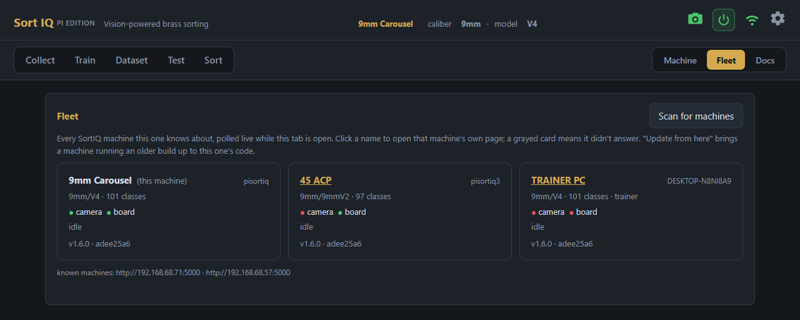

Each machine is self-contained — its own address, name, dataset, and
model — and one trainer PC serves them all. Four rules keep a fleet sane:

- **Unique hostname per machine, set at flash time.** A machine answers
  at `<hostname>.local:5000` (`pisortiq.local:5000`,
  `pisortiq2.local:5000`, …). Two Pis sharing a hostname make that
  `.local` name flip-flop between them — never duplicate one. The
  trainer's **Find machine…** button discovers every machine on the
  network without typing names, and works even when `.local` resolution
  is being moody. For machines that matter, give each a **DHCP
  reservation** in your router and use the IP — mDNS is a convenience,
  reserved IPs are dependable.
- **Name your machines.** Click the name in the page header to label a
  machine ("Line 1", "Shop Left"). The name shows in the header, the
  browser tab title, and the Find-machine list — so five open tabs stay
  tell-apart-able. It's a display label only: renaming never moves files
  or breaks anything.
- **Give each machine's model a unique name.** This is the load-bearing
  rule. The trainer stores its dataset mirrors by *caliber/model* — not
  by machine — so two machines both running `9mm/Default` would map to
  the same trainer folder. The trainer refuses to pull the second
  machine into the first one's mirror (it tells you to rename), so
  nothing mixes silently — but the fix is the convention: name the model
  after the machine's job (`9mm/Master`, `9mm/Secondary`). Each machine
  then gets its own folder on the trainer, switchable with the Dataset
  page's Caliber & model selector.
- **The trainer works with one machine at a time.** Point the machine
  URL (Train page) at whichever machine you're serving — Find machine…
  sets it in one click — and switch the active profile to match. If the
  URL and profile ever disagree, the trainer blocks the pull or install
  and says so.

## The Uno firmware — stock or SortIQ fork?

**SortIQ works out of the box with the stock CS7.2 firmware** — no
flashing required. Everything that matters runs on it: collecting,
training, live sorting, the end-of-brass flush, jam recovery. The app
only ever speaks the stock command set for sorting.

The optional **SortIQ firmware fork** (version `…-SS2`, in
[firmware/](../firmware/README.md)) adds machine-quality upgrades:

- **Per-slot calibration** — jog each slot's arm position in microsteps
  so every chute centers exactly over its funnel (the stock firmware
  uses a rigid evenly-spaced grid)
- **Smoother, faster motion** — true trapezoid acceleration (slot moves
  are also ~30% quicker)
- **More repeatable homing** — a two-stage seek that takes the sensor
  edge at low constant speed every time
- **Feed motion profile** tuned for the camera port and tensioner
- **Pipelined sorting** — the mechanical cycle runs *under* the model's
  think time instead of after it, buying real cases-per-minute
- **Arm dwell** — an adjustable hold before every arm move, clearance
  for brass that tumbles slowly down the arm tube

On stock firmware those extras degrade silently and safely: the
calibration and motion settings are acknowledged by the board but have
no effect, and telemetry simply doesn't appear. Nothing breaks.

**Which one am I running?** The Machine tab's **Firmware** selector
auto-detects on connect; or type `version` in the console — stock
answers `7.2.250925.6.1`, the fork with an `-SS2` suffix. Flashing is
covered in [firmware/README.md](../firmware/README.md) — a five-minute
job from the Pi over the existing USB cable; the stock firmware in
[Seth's repo](https://github.com/sjseth/AI-Case-Sorter-CS7.2) is the
flash-back rollback.

## The touchscreen

An optional 7" touchscreen on the machine's post runs the everyday work
without a phone or PC: sorting, capture, reject review and the machine
controls. The parts, the printed mount and the wiring are in
[hardware/touchscreen](../hardware/touchscreen/); plug it into the Pi
and run `tools/pi_deploy.sh`, and it opens the touchscreen page at every
boot. Everything it does also works from the web app, and the two stay
in step: a run started on one shows on the other.

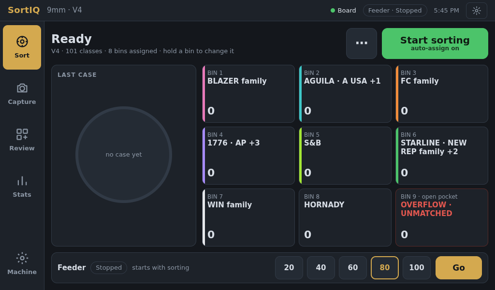

The screen on the machine, in its printed case:

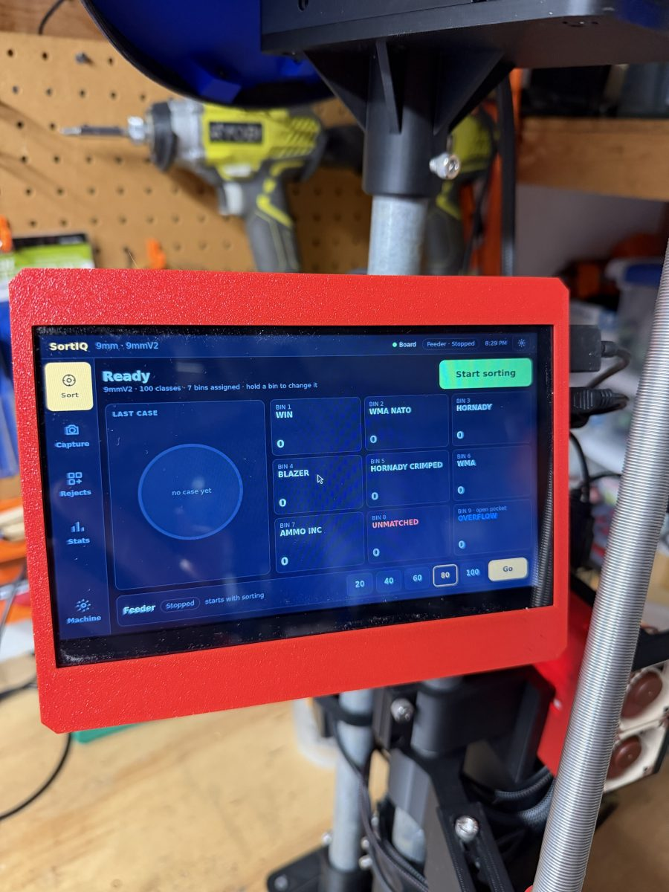

The header shows the active profile, the board's state, the case feeder
(when fitted), the time, and a **gear** for the System page. The pages
down the left side:

- **Sort** — the bins as large cards with their classes and live counts,
  the last case photo with its verdict, and **Start sorting** (the **⋯**
  next to it holds auto-assign and Clear all bins). During a run it shows
  the count, rate and rejects, with **Pause** and **Stop**. **Press and
  hold a bin** to change what goes in it: tap a class to take it out, add
  classes or families from the list, and pick the bin's colour. Bins
  can't change during a run. With the board off, the button is
  **Power on**. With a case feeder fitted, its strip along the bottom
  runs the feeder: pick a speed, **Go** / **Stop**.
- **Capture** — **Single** feeds one case (**Feed one**), shows the
  photo, and files it under the class picked from the list (**Save**).
  **Thin first** puts the classes that need photos at the top. **Batch**
  photographs a whole hopper: a **Mixed lot** comes back grouped by look
  for you to file group by group, and **One class** files the cases that
  look like that class and holds the rest for you to check, the same
  check as the web app's one-class batch.
- **Review** — the newest run's rejects, one at a time or as a grid, with
  the reason each was rejected and buttons to file it into the dataset.
  **Sorted cases** shows what went into each bin, so a wrong sort can be
  filed under the right class too. **Run ▾** opens an older run.
- **Stats** — class and photo counts, the thinnest classes (capture
  those next), the last run's numbers, and the dataset card: **Rebuild
  gallery** after filing rejects or a batch, so the new photos count when
  sorting, and **Copy to USB** for a dataset backup or a fast first pull
  on a new trainer PC. A copy blocks sorting until it finishes; then
  **Eject** and remove the stick when it says so.
- **Machine** — home the wheel, test feed, clear a fault, open and close
  each sort door, switch the IoT relay, board power and case feeder on
  or off, and set the case feeder's speed and whether it starts with
  sorting.
- **System** (the gear) — board power, how long the screen waits before
  it sleeps (5, 10 or 30 minutes, or never) and **Screen off now**, this
  machine's app and board versions, model, network, storage and Pi
  temperature, restart the app, reboot or shut
  down the Pi, and **Network**: the connected Wi-Fi, nearby networks to
  join, and the access point lock for a mesh network. A network change
  made here undoes itself after 60 seconds if the machine loses its
  connection, so a wrong password can't strand it.

**Pauses.** A tube jam or feeder jam pauses the run and covers the
screen with what happened and what to clear, then **Resume** or **Finish
run**. When brass stops arriving, a countdown asks whether the hopper is
empty or a case is stuck; a case arriving closes it by itself.

**Sleep.** The screen goes dark after the idle time set on the System
page, never during a run, and a run starting wakes it. The tap that
wakes it doesn't press anything underneath.

## Docs

The **Docs** tab carries the full built-in reference: the decision flow,
the serial protocol, a training playbook, floor-tuning guidance, the
Pico machines (sort arm and carousel — wiring, host setup, flashing),
the touchscreen, and troubleshooting — always matching the version
you're running.

---

## Tips & troubleshooting

- **`pisortiq.local` won't load** — mDNS being moody; use the Pi's IP
  address (your router's device list has it).
- **Board link drops when motors run** (disconnects mid-run, `err -71`
  storms in the Pi's logs) — that's electrical noise from the steppers
  feeding back through USB. The fix is a cheap USB isolator on the
  board's serial line plus proper machine grounding — see the wiring
  notes in [PI_SETUP.md](PI_SETUP.md). (Camera stays plugged into the
  Pi directly — isolators are too slow for it.)
- **Camera drops mid-run** (cases land in the catch-all unphotographed;
  `uvcvideo … -71` storms in the Pi's logs) — same electrical noise,
  different victim. A shielded, ferrite-choked USB cable on the camera,
  routed away from the motor wiring, prevents it. If the camera stays
  wedged after a drop, unplug/replug its USB — the app reconnects
  automatically.
- **MACHINE FAULT banner** — the machine stopped itself after its own
  recovery failed repeatedly. Clear the physical problem (a jammed case,
  a stuck wheel), then **Clear fault & re-home**: the machine re-homes
  and carries on.
- **A new model generation made accuracy worse** — Train tab → *Previous
  versions* → restore (the model and its gallery restore together). Then
  look at what changed: usually a mislabeled batch (Dataset gallery) or
  an over-split variant class.
- **Lots of "too close to call" rejects for one make** — either two of
  your classes overlap (an over-split variant — merge them), or the pair
  genuinely looks alike and needs more photos of both; rebuild the
  gallery after. A single mislabeled image that became an exemplar also
  causes this — run **Scan for mislabels** on both classes.
- **First dataset pull on a new trainer PC is slow** — it's the one-time
  bulk copy over Wi-Fi; ethernet on the Pi speeds it up dramatically. Or
  use the USB shortcut: insert a stick into the machine, click **Copy
  dataset to USB stick…** on its Train tab, and a popup handles the rest —
  mount, copy with live progress, then **Close & eject** unmounts it and
  says "safe to remove." Drop the stick's `SortIQ/calibers` folder into
  the repo folder on the PC and the pull verifies instead of
  transferring. Re-exports to the same stick only copy new images.
- **Deep links** — every tab is linkable: `#collect`, `#camera`, `#train`,
  `#dataset`, `#test`, `#run`, `#machine`, `#fleet`, `#docs`.
