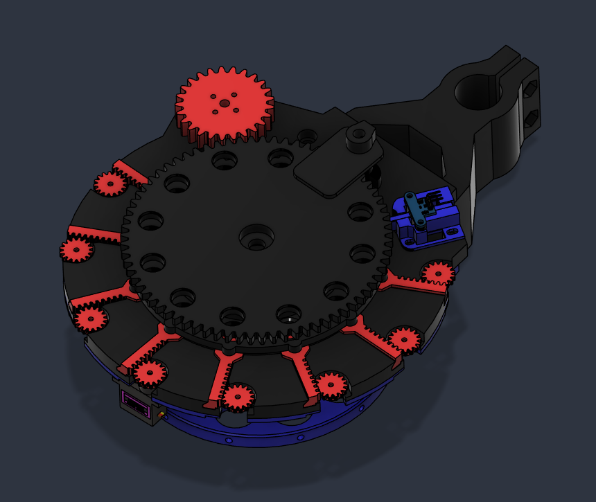
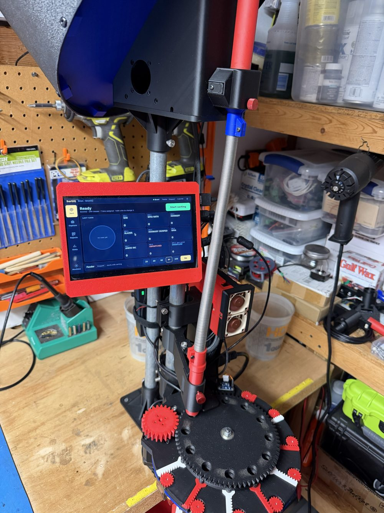
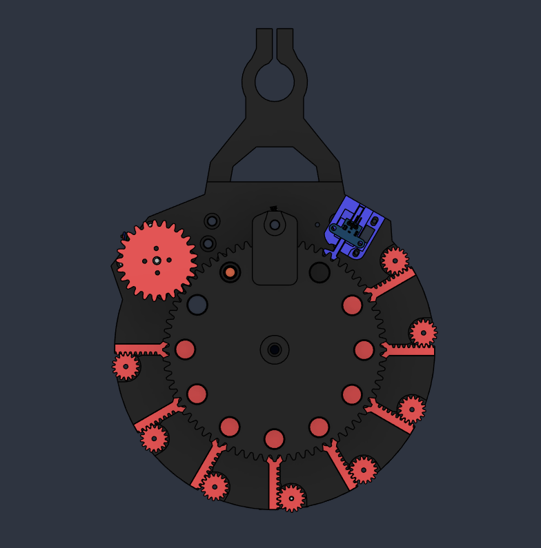
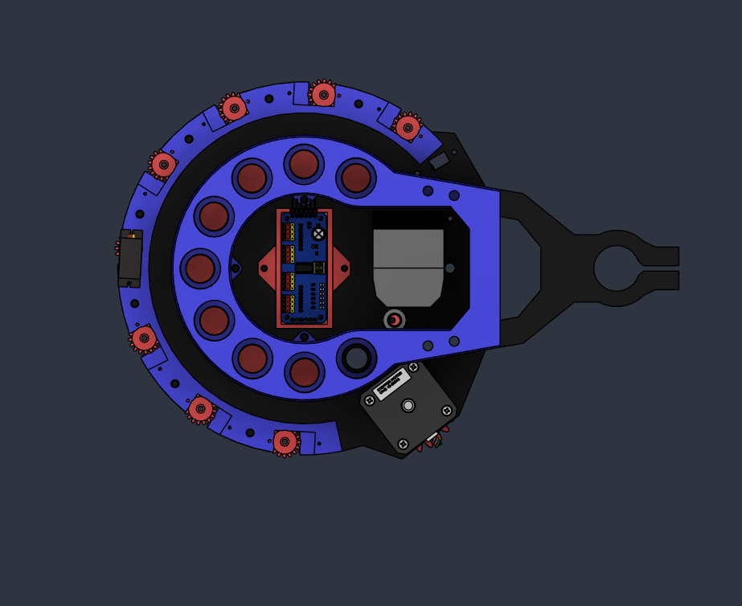
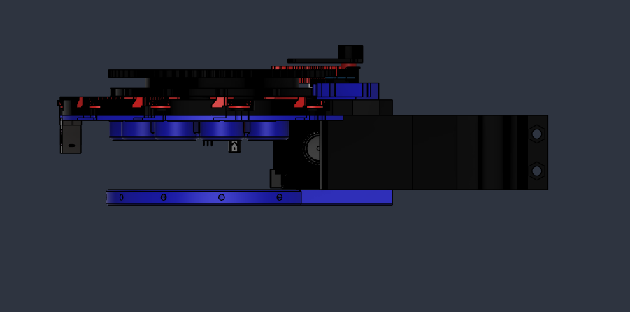

# Servo carousel — the SKR Pico gate-door machine

A 12-station wheel carries each case past the load port, under the
camera, and around to eight servo-driven gate doors. The app reads the
headstamp while the wheel keeps moving, then opens the right door as the
case passes over its bin. Anything still riding after door 8 drops into
the open pocket at the end of the lap, so a missed door always ends in a
reject tray, never in a wrong bin.

It runs the `SortIQ-PicoServo` firmware on an SKR Pico. The Pi drives the
doors directly through a PCA9685 on its I²C bus.

**Building one:** print the parts below, build and wire it, set up the Pi
with the installer, flash the SKR Pico with the image in the repo, and power
it up. The app finds the board and sets it up. The steps are in
[docs/PICO_MACHINE_SETUP.md](../../docs/PICO_MACHINE_SETUP.md).

| Underside | Top side |
|---|---|
|  |  |

## How it moves

- **Wheel**: 12 pockets on a 30° grid, geared to the stepper. A 25-tooth
  pinion drives the wheel's 72-tooth ring gear, which makes
  **9216 microsteps per wheel turn** (`feed_wheel_rev`, the app's
  default).
- **Homing**: a slotted opto reads the wheel's tabs. The firmware homes
  on one tab edge and then checks every crossing against the grid.
- **Doors**: eight rack-and-pinion gates. Each servo pinion drives a
  rack that opens its door. The pulse widths are tuned per door in the
  app (Machine tab, Gate doors).
- **Case sensor**: the M8 inductive sensor at the load port tells the
  firmware a case is staged.
- **Mount**: the pipe clamp fixes the carousel to a post.
- **Case feeder (optional)**: a bowl feeder above the wheel drops cases
  down the feed tube. Its motor and beam run from the same SKR Pico, and
  the app starts and stops it with sorting.

## Parts

| Qty | Part | Notes |
|---|---|---|
| 1 | [Stepper motor](https://www.amazon.com/dp/B0B93HTR87) | Wheel drive, on the SKR Pico's X driver |
| 1 | [Flange for the stepper motor](https://www.amazon.com/dp/B08334MFVT) | Mounts the motor gear on the stepper shaft |
| 2 | [626ZZ bearings](https://www.amazon.com/dp/B0CR915VDT) | Feed wheel bearings |
| 1 | [PCA9685 servo board](https://www.amazon.com/dp/B07RMTN4NZ) | On the Pi's I²C bus |
| 8 | [Servo motors](https://www.amazon.com/dp/B0CP9F18RT) | One per gate door |
| 1 | [Slotted opto homing sensor](https://www.amazon.com/dp/B0CHDRF497) | On X-STOP |
| 1 | [Raspberry Pi 4 or 5](https://www.amazon.com/dp/B0D2WYFS23) | The link is a Pi 5 kit; a Pi 4 works too |
| 1 | Camera: the stock CS7.2 OV3660 module, or the [Suyin HD module](https://www.amazon.com/dp/B094DCNQHQ) (sold as FTVOGUE HBVW202012HD) | Either works; the app detects which one is plugged in. Sits in the stock CS7.2 camera housing (see Printed parts) |
| 1 | [CS7.2 camera light ring](https://shop.sjseth.com/products/cs7-2-camera-light-ring) | Seth's ring, dimmed by the Pi through the MOSFET module |
| 1 | [Spring for the camera tension cam](https://www.amazon.com/dp/B0BRHFY8HR) | Goes with `Tension Cam Camera.stl` |
| 1 | [BIGTREETECH SKR Pico](https://www.amazon.com/dp/B09MVJ5XKH) | |
| 1 | [M8 inductive proximity sensor, LJ8A3-2-Z](https://www.amazon.com/dp/B072M9T26C) | Case sensor, on WD-DET. The linked one is the NPN `-Z/BX`: fit the board's NPN jumper. A PNP `-Z/BY` works too, with that jumper removed |
| 2 | [24 V fans for the controller case](https://www.amazon.com/dp/B0CN39MCPL) | FAN1 and FAN2, full speed from boot |
| 1 | [24 V camera fan](https://www.amazon.com/dp/B08R9J189W) | FAN3, full speed from boot |
| 1 | [MOSFET module for the LED ring](https://www.amazon.com/dp/B0DZP1NCVW) | Power from E0-STOP 5 V, PWM from the Pi's GPIO 18 |
| 1 | [24 V power supply](https://www.amazon.com/dp/B0CW598HV8) | Board, stepper, fans |
| 1 | [5 V power supply](https://www.amazon.com/dp/B0BZL1G6DS) | The servo rail on the PCA9685, with its ground tied to the Pi's |
| 1 | [IoT Relay](https://www.amazon.com/dp/B00WV7GMA2) (optional) | Lets the app switch the 24 V supply (Pi GPIO 25) |
| 1 | [7" HDMI touchscreen](https://www.amazon.com/dp/B09XKC53NH) (optional) | Runs the machine from the post. Its mount, wiring and setup are in [hardware/touchscreen](../touchscreen/) |
| 1 | Case feeder from [Case Feeder Pro](https://github.com/yamanub/Case-Feeder-Pro) (optional) | Fills the wheel from a bowl. Its motor and beam sensor wire to this SKR Pico; see [Case feeder](../../docs/PICO_MACHINE_SETUP.md#case-feeder) |
| 1 | [Geekworm X1001 NVMe hat](https://www.amazon.com/dp/B0CPPGGDQT) and an M.2 2280 NVMe drive, such as the [fanxiang S500 Pro 256 GB](https://www.amazon.com/dp/B0B55SWRCY) (optional, Pi 5) | Boots the Pi from the drive instead of an SD card. The controller case has [NVMe parts](../pico-controller/README.md#nvme-on-a-pi-5) for it; setup is in [PI_SETUP.md](../../docs/PI_SETUP.md#optional-boot-from-an-nvme-drive-pi-5) |

### Screws and hardware

| Qty | Size | Where |
|---|---|---|
| 19 | M4 × 10 | |
| 20 | M2 × 8 | |
| 2 | M6 × 50 | |
| 4 | M6 × 20 | |
| 6 | M6 × 30, with M6 nuts | Post mounts |
| 13 | M3 × 10 | |
| 1 | M3 threaded insert | Camera light shade |
| 1 | [M8 × 1 heat-set threaded insert](https://www.amazon.com/dp/B0C66K4QJR) | Holds the threaded case sensor |

The controller case has its own screw list, in
[hardware/pico-controller](../pico-controller/).

## Printed parts

Printed in PLA at 0.2 mm layers with 4 walls.

The post brackets and the feed tube post mount come in two sizes. The
unmarked version fits the stock CS7.2 post: 3/4 inch pipe and flange,
any 3/4 inch pipe with a 1.050 inch outside diameter. The 1 inch
version fits a 1 inch post.

The camera housing is not in this folder: the carousel uses the stock
CS7.2 camera housing, printed from Seth's original
[AI-Case-Sorter-CS7.2](https://github.com/sjseth/AI-Case-Sorter-CS7.2) repo.

| File | Print | What it is |
|---|---|---|
| `SIQ Classifier.stl` | ×1 | The main classifier base that everything attaches to |
| `SIQ Servo Mount.stl` | ×1 | The plate that holds the eight door servos |
| `SIQ Feed Wheel 9mm.stl` | ×1 | The 12-pocket wheel with its 72-tooth ring gear |
| `SIQ Motor Gear.stl` | ×1 | The 25-tooth drive gear, on the stepper through the flange |
| `SIQ Servo Gear.stl` | ×8 | Door pinions, one per servo |
| `SIQ Servo Rail-Door.stl` | ×8 | Door racks, one per gate |
| `SIQ PCA9685 Mount.stl` | ×1 | Holds the servo board in the middle of the plate |
| `SIQ Feed Bracket.stl` | ×1 | Feed bracket |
| `SIQ 9mm Feed Tube Spring Attachment.stl` | ×1 | Spring attachment for the 9mm feed tube |
| `SIQ Light Shade.stl` | ×1 | Camera light shade; takes the M3 threaded insert |
| `Tension Cam Camera.stl` | ×1 | Camera tension cam |
| `SIQ Tension Cam Shim.stl` | ×1 | Shim for the tension cam |
| `SIQ Post Bracket.stl` or `SIQ Post Bracket 1in.stl` | ×1 | Clamps the carousel to its post: 3/4 inch pipe or 1 inch |
| `SIQ Feed Tube Post Mount.stl` or `SIQ Feed Tube Post Mount 1in.stl` | ×1 | Holds the feed tube on the post: 3/4 inch pipe or 1 inch |
| `SIQ Rotator Mount for IOT.stl` | ×1 | Rotator mount for the IoT Relay (optional) |
| `SIQ Pex Adapter Base.stl` | ×1 | Output base: routes the door drops into PEX tubing |
| `SIQ Pex Support Ring.stl` | ×1 | Support ring for the PEX runs |

## Wiring

The SKR Pico connections, colour-keyed on a board drawing, are in the
setup guide's [SKR Pico wiring](../../docs/PICO_MACHINE_SETUP.md#skr-pico-wiring)
section and in the app's Docs tab under Pico machines.
