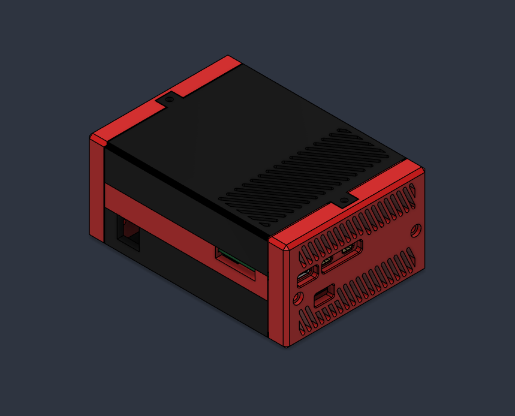
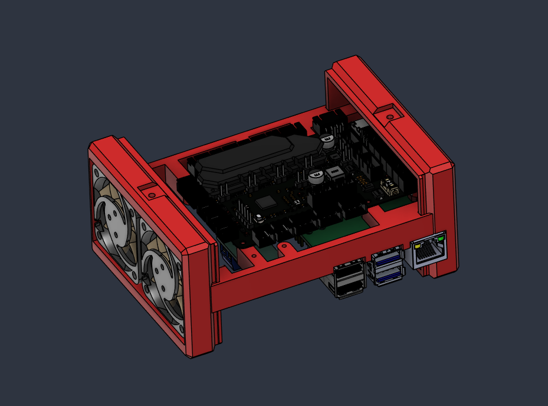
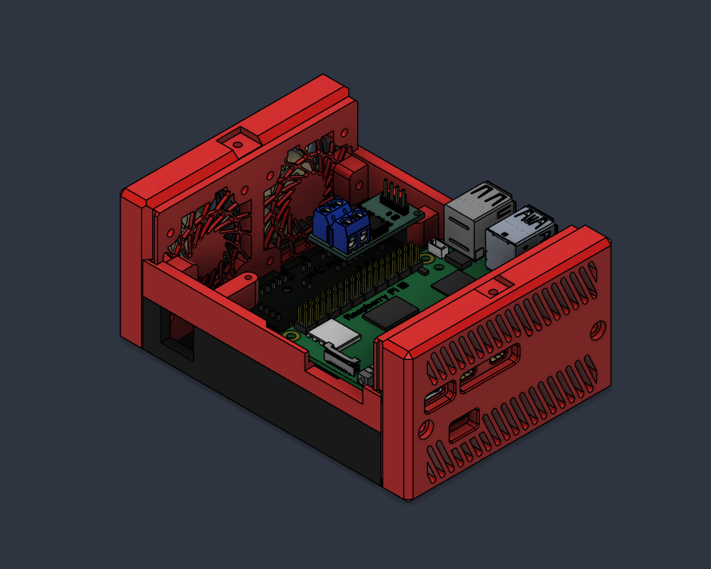
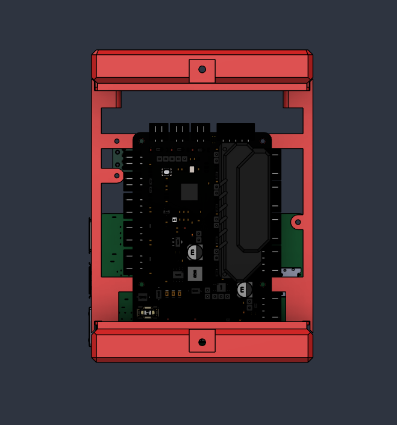
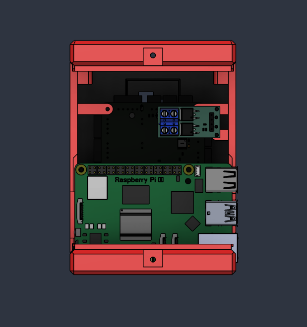

# Pico controller case

One case holds the Raspberry Pi and the SKR Pico stacked on a shared
frame, with the two 24 V case fans in one end cap and the LED ring's
MOSFET module mounted over the Pi. It is the controller for the
[servo carousel](../carousel/).

| SKR Pico side | Pi side |
|---|---|
|  |  |
|  |  |

## Screws

| Qty | Size |
|---|---|
| 3 | M2 × 4 |
| 4 | M3 × 10 |
| 8 | M3 × 12 |

The electronics that go in it (Pi, SKR Pico, fans, MOSFET module) are in
the [carousel parts list](../carousel/README.md#parts).

## Printed parts

Printed in PLA at 0.2 mm layers with 4 walls. Pick the Pi 4 or Pi 5 version of the three parts that differ; the rest
fit both. A Pi 5 with the optional NVMe hat uses the four `NVMe` parts
in place of its two sides, end cap and lid (see
[NVMe on a Pi 5](#nvme-on-a-pi-5)).

| File | Print | What it is |
|---|---|---|
| `CenterSide 1 pi4-5.stl` | ×1 | First long side, either Pi |
| `CenterSide 2 pi4.stl` or `CenterSide 2 pi5.stl` | ×1 | Second long side, for your Pi |
| `End Cap pi4.stl` or `End Cap pi5.stl` | ×1 | Port-end cap, cut for your Pi's connectors |
| `Fan Housing pi4-5.stl` | ×1 | Opposite end: holds the two 24 V case fans |
| `pi4 lid.stl` or `pi5 lid.stl` | ×1 | Lid over the Pi |
| `Pico Lid.stl` | ×1 | Lid over the SKR Pico |
| `CS7.2 Mount with Rotator 1inch post.stl` | ×1 | Mounts the case on a 1 inch pipe post, on a rotator |

### NVMe on a Pi 5

A Pi 5 boots from an SD card as standard. It can boot from an NVMe drive
on a PCIe hat instead, which is faster and more robust than a card. The
hat makes the Pi taller, so the case has its own set of four parts for
it. Print these in place of the Pi 5 versions above:

| File | Print | Replaces |
|---|---|---|
| `NVMe CenterSide 1 pi5.stl` | ×1 | `CenterSide 1 pi4-5.stl` |
| `NVMe CenterSide 2 pi5.stl` | ×1 | `CenterSide 2 pi5.stl` |
| `NVMe End Cap pi5.stl` | ×1 | `End Cap pi5.stl` |
| `NVMe pi5 lid.stl` | ×1 | `pi5 lid.stl` |

Setting the Pi up to boot from the drive is in
[docs/PI_SETUP.md](../../docs/PI_SETUP.md#optional-boot-from-an-nvme-drive-pi-5).

## Wiring

The board connections are in the setup guide's
[SKR Pico wiring](../../docs/PICO_MACHINE_SETUP.md#skr-pico-wiring)
section: the Pi link on the TFT header, the fans, the ring MOSFET's
power, the case sensor on WD-DET with its jumper, the feed motor and
homing opto, and the optional case feeder's motor and beam with its
jumpers.
