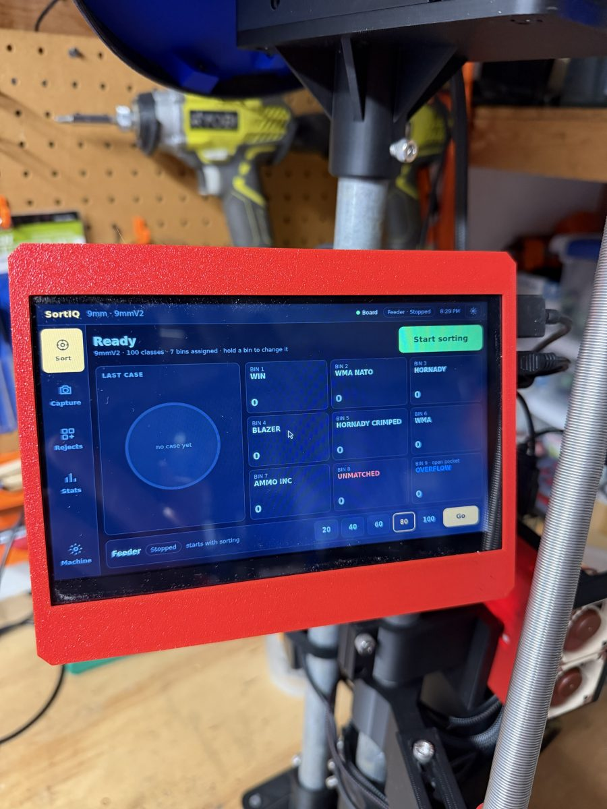

# 7" touchscreen — optional

A 7" touchscreen on the machine's post runs the machine without a phone or
PC. It shows the Sort page with the live bins, starts and stops runs,
captures photos, reviews rejects, and holds the machine and network
controls. The web app still works alongside it, from any browser.

The screen plugs into the Raspberry Pi's HDMI and USB. The installer sets
it up when it finds a screen plugged in. No driver, `config.txt` edits or
desktop are needed.

## Parts

| Qty | Part | Notes |
|---|---|---|
| 1 | [7" HDMI touchscreen, 1024 × 600](https://www.amazon.com/dp/B09XKC53NH) | Sold by Hosyond; the panel is the MPI7002 ([LCD wiki](https://www.lcdwiki.com/7inch_HDMI_Display-C)). Comes with an HDMI cable, a micro-HDMI adapter and a micro-USB cable |

The screen takes about 0.6 A at 5 V from the Pi's USB port, so use the
Pi's full-rated power supply.

## Printed parts

Printed in PLA at 0.2 mm layers with 4 walls. The tube mount fits a
1 inch post.

| File | Print | What it is |
|---|---|---|
| `7in TSC Front.stl` | ×1 | Front bezel around the screen |
| `7in TSC Back.stl` | ×1 | Back cover |
| `7in TSC 1in Tube Mount.stl` | ×1 | Clamps the screen arm to a 1 inch post |
| `Ball End.stl` | ×2 | Ball joint ends, one at each end of the link |
| `Ball Nut.stl` | ×2 | Nuts that lock the ball joints |
| `Connect Link.stl` | ×1 | Link between the screen and the tube mount |

### Screws

| Qty | Size | Where |
|---|---|---|
| 4 | M3 × 6 | Screen front to back |
| 2 | M3 × 6 | Ball ends |

## Connecting it

1. **HDMI:** the screen's HDMI port to the Pi's HDMI port, with the
   HDMI cable and the micro-HDMI adapter. A Pi 4 or 5 has two
   micro-HDMI ports: use **HDMI 0**, the one next to the USB-C power
   socket.
2. **USB:** either of the screen's two micro-USB ports to one of the Pi's
   USB ports. This one cable carries both the touch and the screen's power.
3. **Backlight switch** on the back of the screen: on.

Plug the screen in **before** running `tools/pi_deploy.sh`. The installer
finds it, installs the kiosk, sets the screen's mode and reboots the Pi;
the screen then opens the machine's touchscreen page by itself at every
boot. Adding a screen to a machine that is already set up: plug it in and
run `tools/pi_deploy.sh` again.

Using the screen is covered in the
[user manual](../../docs/USER_MANUAL.md#the-touchscreen).
